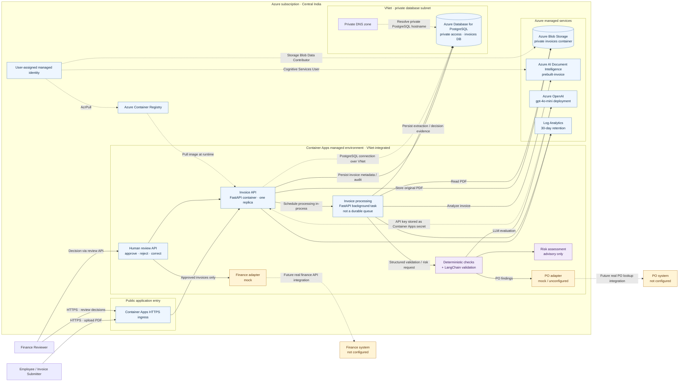

# Intelligent Invoice Processing — application architecture

The diagram represents the Azure deployment described by [`main.bicep`](./main.bicep).
The Container App is optional in the template (`deployApplication=false` by default).

## Runtime flow

1. A submitter uploads a PDF over HTTPS. The API checks the file and stores the original in
   Blob Storage, then records invoice state in PostgreSQL.
2. The API schedules processing as a FastAPI background task in the same Container App
   process. There is no separate worker or durable queue in this deployment.
3. Document Intelligence extracts invoice fields. Deterministic validation and the
   LangChain/Azure OpenAI workflows evaluate invoice and PO findings; risk results are
   advisory only.
4. The extraction, validation, risk assessment, and audit events are stored in PostgreSQL.
   The invoice remains in human review; AI cannot approve or submit it.
5. A reviewer uses the authenticated review API. A human approval can trigger finance
   submission through the current mock adapter. The mock PO and finance adapters do not
   contact real systems.

## Trust and access notes

- Container Apps ingress is external HTTPS. The current API uses the configured reviewer
  shared key, not an enterprise identity provider.
- PostgreSQL is configured with private network access and DNS integration in the VNet.
- Blob public access and shared-key authorization are disabled; the runtime identity is
  assigned Blob Data Contributor. The storage account public network endpoint is still
  enabled in this template.
- Document Intelligence local/key authentication is disabled; the runtime identity receives
  Cognitive Services User.
- ACR admin credentials are disabled; the runtime identity receives AcrPull.
- Azure OpenAI uses an API key injected into the Container App as a secret.
- Log Analytics receives app logs. Do not log invoice content, credentials, or reviewer
  authorization headers.
- The app is pinned to one replica because its background processing is not durable or
  coordinated across replicas. Add a durable queue and worker before scaling horizontally.
